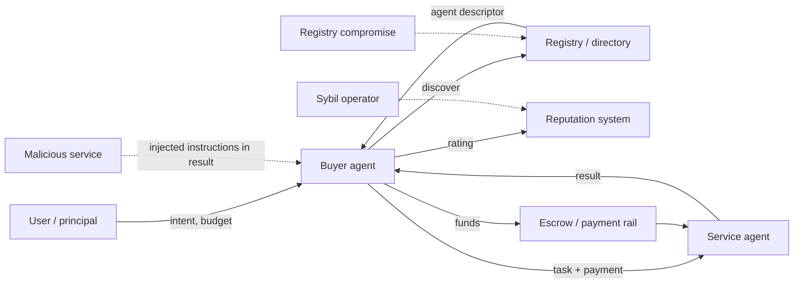

# The Agent Economy Threat Model

Software agents built on language models are starting to buy and sell services from each other. A research agent pays a data agent per query; a travel agent hires a booking agent; a coding agent rents compute from a sandbox provider. To make that work, agents need ways to **discover** each other, **communicate**, **pay**, **build reputation** and **resolve disputes**. Each of these is a new attack surface, and the parties on the other side are increasingly automated, fast and possibly adversarial. This book is about securing those marketplaces.

It is distinct from **ai-agent-supply-chain**, which covers tools, plugins and packages an agent installs, and from **ai-agent-wallet-security**, which covers how one agent holds and protects keys. Here the focus is the interactions *between* agents and the market infrastructure that connects them.

## The moving parts

| Layer | What it does | Example mechanisms (check current specs) |
|---|---|---|
| Identity | who is this agent and who operates it | domain-bound agent descriptors, signed cards, on-chain registries, DIDs |
| Discovery | find agents offering a capability | registries, directories, search, well-known URLs |
| Communication | exchange tasks, results and messages | agent-to-agent protocols over HTTP/JSON-RPC; MCP for agent-to-tool |
| Payment | move value per task or per call | stablecoin transfers, HTTP 402-style pay-per-request flows, payment channels, card rails |
| Authorisation | limit what an agent can spend or do | session keys, spending caps, scoped tokens |
| Reputation | decide whom to trust | ratings, stake, attestations, transaction history |
| Dispute resolution | fix failed or fraudulent deals | escrow, arbitration, optimistic challenges |

The protocols in this space are young and change quickly. The Model Context Protocol (MCP), introduced by Anthropic in late 2024, standardises how agents connect to tools and data sources. Several agent-to-agent protocols, such as Google's Agent2Agent (A2A) announced in 2025, define how agents describe capabilities and exchange tasks. HTTP 402-based payment schemes such as Coinbase's x402 propose paying for API calls in stablecoins inline with HTTP requests. This book describes these patterns generically; always read the current specification of whatever you deploy.

## Assets and adversaries

**Assets:** funds (wallet balances, escrowed payments, prepaid credit), data (user data passed between agents, proprietary results), authority (delegated permissions, session keys, API tokens), reputation scores, and the principal's intent (the user's actual goal).

**Adversaries:**

- **Malicious service agent**: takes payment and returns nothing, garbage or poisoned output; embeds instructions in output to hijack the buyer.
- **Malicious buyer agent**: obtains service and avoids payment; floods providers; files false disputes.
- **Sybil operator**: creates many identities to fake reputation or reviews.
- **Colluding agents**: coordinate prices, ratings or disputes.
- **Infrastructure attacker**: compromises a registry, facilitator or relay to redirect discovery or payments.
- **Compromised principal account**: a stolen API key or session key used to drain budgets.

## Why this is harder than ordinary e-commerce

- **Speed and scale.** Agents can execute thousands of transactions a minute, so a flaw drains budgets before a human notices.
- **Untrusted text is also control input.** An agent reads a counterparty's output as text, and language models can treat text as instructions. Every response from another agent is a potential prompt injection (chapter 2).
- **Weak identity.** An agent is a program and a key; creating a new one is nearly free, which makes Sybil attacks cheap (chapter 5).
- **Irreversible payments.** Stablecoin transfers settle quickly and cannot be charged back, unlike card payments.
- **Ambiguous quality.** Was the summary "good"? Disputes over subjective work are hard to automate (chapter 4).

## Design principles

1. **Least authority.** Agents get spending caps, allow-listed counterparties and short-lived session keys, not a wallet's full key.
2. **Separate data from instructions.** Output from other agents is data; it never changes the buyer's goals or permissions without a deterministic policy check.
3. **Verify, then pay.** Where outputs can be checked by a tool (tests pass, a proof verifies, a signature is valid), make payment release depend on that check.
4. **Make identity costly.** Reputation should be tied to stake, verified domains or other scarce resources.
5. **Assume the market is adversarial.** Test with adversarial agents before going live.

## Worked example

Write a threat model for a single agent purchase. Not executed: this is a paper exercise.

1. Pick a scenario: a buyer agent pays a translation agent US$0.05 per document via a stablecoin micropayment.
2. Draw the flow in the diagram above, labelling each arrow with the data and value that crosses it.
3. For each arrow, list STRIDE threats (spoofing, tampering, repudiation, information disclosure, denial of service, elevation of privilege).
4. For each threat, name one control from this book's chapters (session key cap, escrow, output validation, reputation stake).
5. Identify the single control whose failure would cost the most, and decide how you would test it.

## Common pitfalls

- Treating a counterparty agent's output as trusted instructions.
- Giving agents unrestricted wallet keys instead of capped session keys.
- Copying protocol details from blog posts instead of the current specification.
- Building reputation on free identities.
- Assuming payment disputes can be resolved like card chargebacks on irreversible rails.

## Exercises

1. Complete the worked example for two scenarios: a data-purchase agent and a compute-rental agent, and compare the top threats.
2. Read the current MCP specification's security section and one agent-to-agent protocol's security section, and list three controls each requires or recommends.
3. Identify which assets in your threat model are irreversible once lost and propose a detection control for each.

## Further reading

- [Model Context Protocol specification](https://modelcontextprotocol.io/)
- Greshake et al., "Not what you've signed up for: Compromising Real-World LLM-Integrated Applications with Indirect Prompt Injection", AISec 2023.
- [OWASP Top 10 for LLM Applications](https://genai.owasp.org/)
- **ai-agent-wallet-security**, **ai-agent-supply-chain**, **account-abstraction-security**
