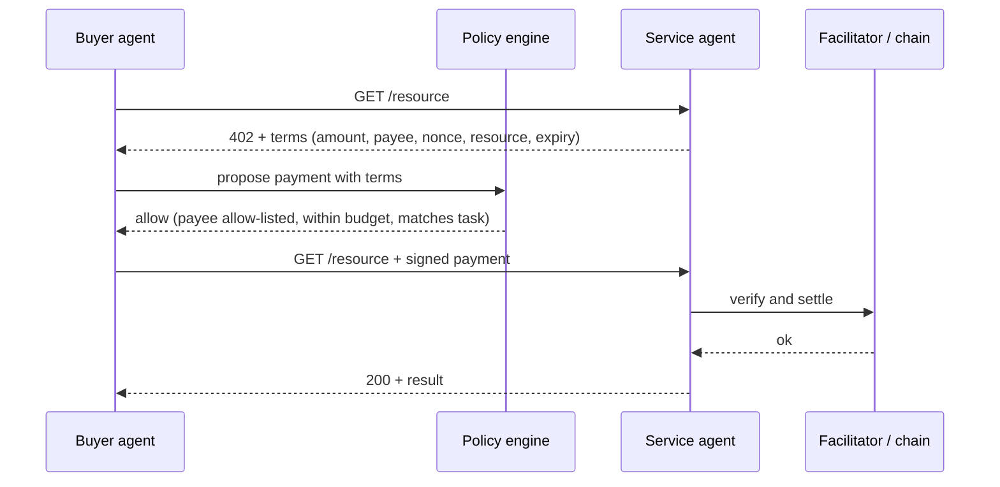

# Agent Payments: Micropayments, HTTP 402 Flows and Session Keys

Agents that buy services need a way to pay that is fast, cheap, programmable and safe to hand to software. Card payments are slow to settle, reversible and designed for humans. Stablecoins on low-fee chains, payment channels and pay-per-request HTTP schemes fit agent workloads better, but they move irreversible value at machine speed. This chapter covers the payment patterns, their failure modes and the authorisation controls, especially session keys, that keep an agent's spending inside its mandate.

## Payment patterns

| Pattern | How it works | Strengths | Risks |
|---|---|---|---|
| Direct transfer | buyer sends a stablecoin transfer, service checks it on-chain | simple, transparent | latency, fee per call, replay of one transfer for many calls if not bound to a task |
| HTTP 402 pay-per-request | server answers `402 Payment Required` with terms; client retries with a signed payment in a header; a facilitator may verify and settle | fits API calls, no accounts needed | binding terms to the resource, nonce replay, facilitator trust |
| Prepaid balance or credits | buyer deposits, service debits per call | cheap per call | custodial risk, balance disputes |
| Payment channels / streaming | off-chain signed balance updates, settled later | very cheap per call | channel state management, stale-state submission |
| Escrow per task | funds locked until delivery is accepted or a dispute resolves | protects both sides | complexity, dispute costs (chapter 4) |

HTTP status code 402 was reserved "for future use" in early HTTP specifications. Recent proposals, notably Coinbase's x402 (2025), define how a server states payment requirements in a 402 response and how a client attaches a signed stablecoin payment to its retry. Read the current specification of any such scheme before relying on its details; this chapter describes the pattern.



## What the signed payment must bind

A payment authorisation is safe only if it commits to everything that matters:

- **amount and asset** (and chain), so it cannot be redirected to a different token or network;
- **payee**, so it cannot be redeemed by someone else;
- **resource or task ID**, so one payment does not unlock other resources;
- **nonce**, single use, so it cannot be replayed;
- **expiry**, so captured authorisations become useless quickly.

On EVM chains, token standards with signed authorisations (such as EIP-3009 `transferWithAuthorization`, used by some stablecoins) and typed-data signing (EIP-712, with a domain separator bound to chain and contract) provide most of these properties. The service must still check that the signed terms match the request it is serving.

## Session keys and spending policy

Never give an agent the master key of a wallet. Give it a **session key**: a key that a smart account accepts only under a policy. With ERC-4337 smart accounts and modular account standards (ERC-7579), and with EIP-7702 delegation for externally owned accounts, policies can be enforced on-chain:

| Policy | Example |
|---|---|
| Spending cap | at most 20 USDC per day |
| Payee allow-list | only these service contracts or addresses |
| Asset restriction | only USDC on one chain |
| Expiry | key valid for 24 hours |
| Function restriction | may call `transfer` on the token contract, nothing else |

On-chain enforcement matters because it holds even if the agent is fully compromised by prompt injection. Off-chain policy engines (chapter 2) add context-aware checks, such as "this payment matches the user's current task", that are hard to express on-chain. Use both. Details of session key modules and their pitfalls are covered in **account-abstraction-security** and **ai-agent-wallet-security**.

## Failure modes

- **Replay**: the same signed payment accepted twice, or accepted for a different resource.
- **Overcharging**: the 402 terms quote a higher amount than advertised; the buyer pays because no policy compares them with the descriptor or a budget.
- **Pay without delivery**: service takes payment and returns an error or junk. Mitigated by escrow, small increments or verify-then-pay.
- **Facilitator trust**: a third party that verifies and settles payments can censor or misreport. Check what it can and cannot do.
- **Fee and price manipulation**: dynamic pricing combined with automated buyers invites gouging and collusion (chapter 5).

## Worked example

Simulate a 402 flow with replay and resource binding checks, using only the Python standard library. Executed while writing this book (Python 3, localhost only); the output shown is what was observed. No real funds or chain are involved: an HMAC stands in for a signed payment authorisation.

```python
# Toy HTTP 402 pay-per-request flow. No real money: an HMAC stands in for a signed payment.
import hmac, hashlib, json, secrets, threading
from http.server import BaseHTTPRequestHandler, HTTPServer
from urllib.request import Request, urlopen
from urllib.error import HTTPError

KEY = b"buyer-session-key"          # shared only for the toy; real schemes use signatures
PRICE, PAYTO = 5, "service-agent-1"
issued, spent = set(), set()

class Svc(BaseHTTPRequestHandler):
    def log_message(self, *a): pass
    def do_GET(self):
        p = self.headers.get("X-Payment")
        if p:
            d = json.loads(p)
            body = json.dumps(d["terms"], sort_keys=True).encode()
            ok = (hmac.compare_digest(d["mac"], hmac.new(KEY, body, hashlib.sha256).hexdigest())
                  and d["terms"]["nonce"] in issued and d["terms"]["nonce"] not in spent
                  and d["terms"]["resource"] == self.path and d["terms"]["amount"] >= PRICE
                  and d["terms"]["payTo"] == PAYTO)
            if ok:
                spent.add(d["terms"]["nonce"])
                self.send_response(200); self.end_headers(); self.wfile.write(b"result"); return
        nonce = secrets.token_hex(8); issued.add(nonce)
        self.send_response(402); self.send_header("Content-Type", "application/json"); self.end_headers()
        self.wfile.write(json.dumps({"amount": PRICE, "payTo": PAYTO, "nonce": nonce,
                                     "resource": self.path}).encode())

def buyer(url, budget=10, payee_allowlist=("service-agent-1",)):
    try:
        return urlopen(url).read()
    except HTTPError as e:
        if e.code != 402: raise
        terms = json.loads(e.read())
    # Deterministic policy, outside any model
    assert terms["payTo"] in payee_allowlist and terms["amount"] <= budget, "policy refused"
    mac = hmac.new(KEY, json.dumps(terms, sort_keys=True).encode(), hashlib.sha256).hexdigest()
    hdr = json.dumps({"terms": terms, "mac": mac})
    return urlopen(Request(url, headers={"X-Payment": hdr})).read(), hdr

srv = HTTPServer(("127.0.0.1", 0), Svc); port = srv.server_port
threading.Thread(target=srv.serve_forever, daemon=True).start()
url = f"http://127.0.0.1:{port}/translate"
body, hdr = buyer(url)
print("paid call:", body)
try:
    urlopen(Request(url, headers={"X-Payment": hdr})); print("replay: ACCEPTED (bug)")
except HTTPError as e:
    print("replay:", e.code)
try:
    urlopen(Request(f"http://127.0.0.1:{port}/other", headers={"X-Payment": hdr})); print("cross-resource: ACCEPTED (bug)")
except HTTPError as e:
    print("cross-resource:", e.code)
srv.shutdown()
```

1. Save the script as `pay402.py` and run `python3 pay402.py`.
2. Observed output: `paid call: b'result'`, then `replay: 402` and `cross-resource: 402`. The nonce check blocks replay; the resource binding blocks reuse on `/other`.
3. Remove `and d["terms"]["nonce"] not in spent` from the server check and rerun. Observed: `replay: ACCEPTED (bug)`, while the cross-resource check still returned 402.
4. Call `buyer(url, budget=3)`. Observed: `AssertionError: policy refused`, raised before any payment is signed.
5. Optionally replace the HMAC with EIP-712 signatures on a local Anvil chain to test real signature binding (not executed for this book; verify locally).

## Common pitfalls

- Signed payments that omit the resource or task ID, letting one payment unlock many calls.
- Nonces tracked in memory only, so restarts re-enable replays.
- Agents holding a wallet's master key rather than a capped session key.
- Trusting the 402 response's amount without checking it against an advertised price or budget.
- Testing payment flows on mainnet instead of a local chain or testnet.

## Exercises

1. Extend the worked example with an `expiry` field and a test that an expired payment is rejected.
2. On a local Anvil chain, deploy a smart account with a session key module (following a current ERC-7579 implementation's docs) and verify that a transfer above the daily cap reverts.
3. Write a policy engine function that compares 402 terms against a service descriptor's advertised price and the user's task budget, with unit tests for overcharging.

## Further reading

- [x402 protocol](https://github.com/coinbase/x402) (check the current specification)
- [EIP-712](https://eips.ethereum.org/EIPS/eip-712) and [EIP-3009](https://eips.ethereum.org/EIPS/eip-3009)
- [ERC-4337](https://eips.ethereum.org/EIPS/eip-4337), [ERC-7579](https://eips.ethereum.org/EIPS/eip-7579), [EIP-7702](https://eips.ethereum.org/EIPS/eip-7702)
- [RFC 9110, section 15.5.3 (402 Payment Required)](https://www.rfc-editor.org/rfc/rfc9110#section-15.5.3)
- **account-abstraction-security**, **ai-agent-wallet-security**
