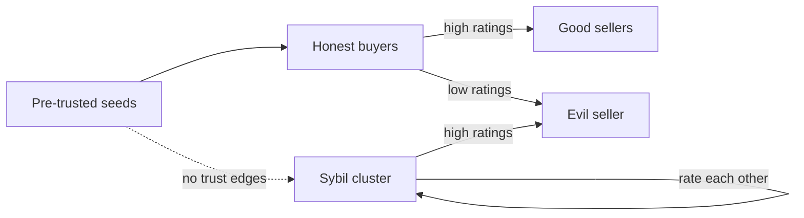

# Reputation, Sybil Resistance and Collusion

In a market of software agents, reputation is how buyers decide whom to trust with money and data. It is also the first thing attackers target, because a good reputation converts directly into sales and because creating new agent identities is almost free. This chapter covers reputation designs, Sybil attacks against them, and collusion among agents, which ranges from fake reviews to emergent price coordination.

## Reputation signals

| Signal | Example | Sybil cost | Notes |
|---|---|---|---|
| Ratings from counterparties | 1-5 stars after a task | very low if raters are free identities | needs weighting by rater credibility |
| Transaction history | number and volume of completed, paid tasks | low (wash trading between own agents) | weight by counterparty diversity and fees paid |
| Stake or bond | tokens locked and slashable on proven misconduct | proportional to stake | requires a credible slashing process |
| Verified operator identity | domain ownership, legal entity, KYC | medium to high | privacy trade-offs |
| Third-party validation | re-execution of tasks, TEE attestations, audits | depends on validator independence | strongest for checkable tasks |
| Time in market | age of identity with consistent behaviour | time, not money | slows attackers, does not stop patient ones |

Some on-chain proposals, such as the draft ERC-8004 ("Trustless Agents"), propose registries for agent identity, reputation feedback and validation records. Check the current status of any such standard before building on it; drafts change.

## Sybil attacks

John Douceur's "The Sybil Attack" (IPTPS 2002) showed that without a trusted authority or resource cost, one entity can always present many identities. In agent markets this enables:

- **Ballot stuffing**: many fake buyers rate the attacker's service highly.
- **Bad-mouthing**: fake buyers rate competitors poorly.
- **Whitewashing**: an agent with a bad reputation abandons it and re-registers.
- **Wash trading**: the attacker's agents pay each other to build volume history.

Defences combine raising identity cost and weighting trust by its source:

1. **Costly identity**: stake, fees per rating, verified domains.
2. **Trust propagation from seeds**: algorithms such as EigenTrust (Kamvar, Schlosser, Garcia-Molina, WWW 2003) compute global trust by propagating local trust from a set of pre-trusted peers, so a cluster of Sybils that only rate each other gains little.
3. **Ratings tied to paid transactions**: only counterparties of a real, fee-paying transaction can rate, making ballot stuffing cost money.
4. **Diversity weighting**: volume from a few counterparties counts less than volume from many independent ones.
5. **Newcomer limits**: new identities get small task sizes and escrow by default (chapter 4).



## Collusion

Collusion is coordination between agents against the market or third parties.

- **Rating rings**: groups of operators rate each other. Detectable with graph analysis (dense clusters with few external edges).
- **Dispute collusion**: buyer and resolver, or seller and validator, coordinate rulings. Mitigated by random selection of resolvers, bonds and appeals.
- **Price collusion**: pricing agents that learn from market feedback can converge on supra-competitive prices without explicit communication. Calvano et al., "Artificial Intelligence, Algorithmic Pricing, and Collusion" (American Economic Review, 2020), showed Q-learning pricing agents learning collusive strategies in simulation.
- **Covert channels between LLM agents**: research such as Motwani et al., "Secret Collusion among AI Agents: Multi-Agent Deception via Steganography" (NeurIPS 2024), studies whether language-model agents can hide coordination inside innocuous-looking messages, which complicates monitoring.

Detecting collusion is statistical: compare observed prices, ratings and dispute outcomes with what independent agents would produce, and investigate outliers. Any model used to flag suspicious patterns produces leads; confirmation comes from transaction records and graph evidence that a human or deterministic rule can audit.

## Worked example

Show how a Sybil cluster inflates a naive average and how seed-based trust propagation resists it. Executed while writing this book with Python 3; the output shown is what was observed with `random.seed(1)`.

```python
# Compare naive average ratings with an EigenTrust-style score under a Sybil attack.
import random
random.seed(1)
honest = [f"h{i}" for i in range(20)]
good_sellers, bad_seller = ["s1", "s2", "s3"], "evil"
sybils = [f"sy{i}" for i in range(30)]
peers = honest + sybils
ratings = {}  # (rater, ratee) -> local trust >= 0
for h in honest:
    for s in good_sellers: ratings[(h, s)] = random.uniform(0.7, 1.0)
    ratings[(h, bad_seller)] = random.uniform(0.0, 0.1)
for sy in sybils:
    ratings[(sy, bad_seller)] = 1.0
    for other in sybils:
        if other != sy: ratings[(sy, other)] = 1.0

def naive(target):
    rs = [v for (a, b), v in ratings.items() if b == target]
    return sum(rs) / len(rs)

def eigentrust(pretrusted, iters=50, alpha=0.15):
    nodes = sorted({x for k in ratings for x in k} | set(pretrusted))
    out = {n: {} for n in nodes}
    for (a, b), v in ratings.items(): out[a][b] = v
    p = {n: (1 / len(pretrusted) if n in pretrusted else 0.0) for n in nodes}
    t = dict(p)
    for _ in range(iters):
        new = {n: 0.0 for n in nodes}
        for a in nodes:
            tot = sum(out[a].values())
            if tot == 0:
                for n in nodes: new[n] += t[a] * p[n]
                continue
            for b, v in out[a].items(): new[b] += t[a] * v / tot
        t = {n: (1 - alpha) * new[n] + alpha * p[n] for n in nodes}
    return t

t = eigentrust(pretrusted=honest[:3])
for s in good_sellers + [bad_seller]:
    print(f"{s:5s} naive={naive(s):.2f} eigentrust={t[s]:.4f}")
```

1. Save as `trust.py` and run `python3 trust.py`.
2. Observed output:

```text
s1    naive=0.83 eigentrust=0.1375
s2    naive=0.85 eigentrust=0.1479
s3    naive=0.87 eigentrust=0.1652
evil  naive=0.62 eigentrust=0.0087
```

3. Interpretation: honest buyers rate `evil` below 0.1, but 30 Sybils lift its naive average to 0.62. EigenTrust-style propagation from three pre-trusted honest buyers gives `evil` a score more than an order of magnitude below the good sellers, because no trust flows from the seeds into the Sybil cluster.
4. Add `ratings[("h0", "sy0")] = 1.0` before `naive` is defined, so one pre-trusted honest buyer rates a Sybil highly, and rerun. Observed: `evil` rose from 0.0087 to 0.0125 and the good sellers' scores fell (for example `s1` from 0.1375 to 0.1049). A single careless or compromised seed account lets trust leak into the Sybil cluster, which is why seed sets need protection and review.

## Common pitfalls

- Averaging ratings from free identities.
- Pre-trusted seed sets that are small, static and themselves capturable.
- Counting transaction volume without checking counterparty diversity.
- Treating a model's collusion flag as proof rather than a lead.
- Letting agents with fresh identities take large escrowed jobs immediately.

## Exercises

1. Run the worked example, then add a wash-trading signal (Sybils paying `evil` for tasks) and design a diversity-weighted volume score that resists it.
2. Build a graph of ratings from the simulation and use a community-detection algorithm (for example, from NetworkX) to flag the Sybil cluster.
3. Implement two simple Q-learning pricing agents in a repeated duopoly and observe whether prices drift above the competitive level; compare with the setup in Calvano et al.

## Further reading

- Douceur, "The Sybil Attack", IPTPS 2002.
- Kamvar, Schlosser, Garcia-Molina, "The EigenTrust Algorithm for Reputation Management in P2P Networks", WWW 2003.
- Calvano, Calzolari, Denicolò, Pastorello, "Artificial Intelligence, Algorithmic Pricing, and Collusion", American Economic Review, 2020.
- Motwani et al., "Secret Collusion among AI Agents: Multi-Agent Deception via Steganography", NeurIPS 2024.
- [ERC-8004 draft](https://eips.ethereum.org/EIPS/eip-8004) (check current status)
- **governance-attack-engineering**, **p2p-network-attacks**
