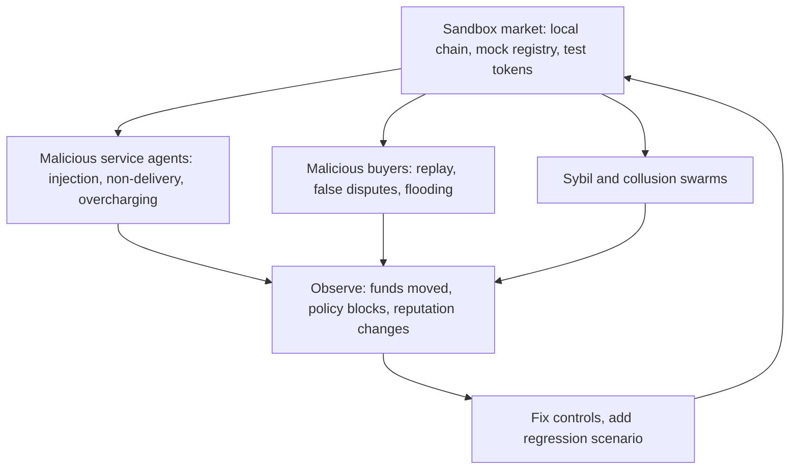

# A Security Programme for Agent Marketplaces

The previous chapters covered each layer of an agent economy separately: discovery and communication, payments, escrow, reputation and collusion. This chapter combines them into a programme that a marketplace operator, an agent developer or an auditor can run. It gives a layered checklist, a testing plan with adversarial agents, monitoring and incident response guidance, and open research directions.

## Roles and responsibilities

| Role | Owns | Key controls |
|---|---|---|
| Marketplace / registry operator | listings, discovery, ranking, dispute process | descriptor verification, Sybil resistance, rate limits, transparent ranking, resolver integrity |
| Buyer agent developer | the agent that spends a principal's money | session keys with caps, policy engine outside the model, untrusted-content quarantine, verify-then-pay |
| Service agent developer | the agent that sells | authentication, payment verification and replay protection, output provenance, rate limiting |
| Payment facilitator | verification and settlement | clear trust model, signature and nonce checks, monitoring for anomalies |
| Principal (user or business) | budget and intent | sets limits, reviews spending, approves high-value actions |

## Layered checklist

**Identity and discovery**
- [ ] Agent descriptors served over HTTPS and signed; buyers verify signatures and pin keys for repeat counterparties.
- [ ] Endpoints bound to the descriptor's domain or explicitly delegated.
- [ ] Capability claims tested before use; results feed reputation.

**Communication**
- [ ] Mutual authentication with short-lived tokens.
- [ ] Task lifecycle enforced as a state machine; invalid transitions rejected and tested.
- [ ] Message size, rate and schema limits; webhook URLs validated against internal address ranges.

**Prompt injection**
- [ ] Counterparty output treated as data; parsed by a tool-less model or code into structured fields.
- [ ] Policy engine outside the model enforces payees, budgets and allowed actions.
- [ ] Every payment references the originating user task and stays within its budget.
- [ ] Injection test suite run on every agent release; policy block rate for out-of-intent actions is 100%.

**Payments**
- [ ] Signed payments bind amount, asset, chain, payee, resource or task ID, nonce and expiry.
- [ ] Nonces persisted so restarts do not re-enable replay.
- [ ] Agents use session keys with on-chain caps, allow-lists and expiry; master keys never reach agents.
- [ ] Quoted prices compared with advertised prices before paying.

**Escrow and disputes**
- [ ] Escrow state machine invariant-tested (Foundry or equivalent); reentrancy and token quirks covered.
- [ ] Verify-then-pay for checkable deliverables; checker agreed before work starts.
- [ ] Disputes require bonds; resolvers randomised or decentralised, with appeal.
- [ ] Model-assisted judging limited to triage and claim extraction, with logged inputs and versions.

**Reputation**
- [ ] Ratings only from paid counterparties; weighted by rater trust and diversity.
- [ ] Seed-based trust propagation or stake-weighted scores; seeds reviewed regularly.
- [ ] Newcomer limits on task size; collusion detection on rating and dispute graphs.

## Adversarial testing

Build a sandbox market with a local chain (Anvil or similar), mock registry and test tokens. Script adversarial agents for each threat in chapter 1, and run them against your agents and contracts on every release. Measure outcomes with numbers that do not depend on a model's opinion: funds lost, policy blocks, invalid transitions accepted, reputation of known-bad agents. Never run adversarial agents against other people's production marketplaces; coordinate with operators and use their bug bounty or security contact for anything you find.

## Monitoring and incident response

- **Spending anomalies**: per-agent and per-principal spend rate, new payees, price outliers. Alert and automatically pause session keys above thresholds.
- **Injection indicators**: proposed actions blocked by the policy engine, grouped by counterparty. A counterparty whose outputs repeatedly trigger blocks is a suspect.
- **Reputation shocks**: sudden rating bursts, new dense clusters in the rating graph.
- **Kill switches**: revoke session keys, pause escrow contracts (with transparent governance), delist agents.
- **Post-incident**: preserve message logs with provenance tags, transaction hashes and policy decisions, so the sequence of events can be reconstructed without relying on a model's account. See **ai-agent-wallet-security** and **decentralized-threat-intelligence** for related practices.

## Research directions

- **Formal models of agent protocols.** Task lifecycles, payment binding and escrow are small state machines that could be specified and proved (see **lean4-security-proofs**) and checked against implementations.
- **Provable separation of data and instructions** for language-model agents remains unsolved; today's defences are architectural.
- **Sybil-resistant reputation without strong identity**, balancing privacy with cost of identity.
- **Detecting covert coordination** between language-model agents, including steganographic channels.
- **Verifiable task completion** with zero-knowledge or TEE-based attestation of execution, extending verify-then-pay to more task types.

## Worked example

Run a one-day adversarial exercise against your own agent. Not executed for this book; verify locally.

1. Start a local chain with Anvil, deploy a test stablecoin, a smart account with a session-key module capped at 10 test tokens per day, and the escrow contract from chapter 4.
2. Run the 402 mock service from chapter 3 and the injection mock from chapter 2, configured to return injected instructions in half of responses.
3. Give your buyer agent a task with a budget of 5 test tokens and let it run 200 tasks.
4. Record: total spent, number of model-proposed out-of-intent actions, number blocked by the policy engine, any replayed or duplicated payments, and any on-chain transfers above caps.
5. Treat any unblocked out-of-intent action or over-cap transfer as a failed control; fix and repeat.

## Common pitfalls

- Testing only the happy path of payments and tasks.
- Measuring security by how often the model refuses, instead of by what the policy layer enforces.
- Running adversarial tests against third-party production systems.
- Logging model outputs without provenance, making incidents impossible to reconstruct.
- Treating draft agent and payment standards as stable.

## Exercises

1. Turn the layered checklist into a scored audit template and apply it to one open-source agent framework's payment or delegation features.
2. Implement the worked example and publish the five metrics from step 4 for two versions of your agent.
3. Choose one research direction and write a one-page proposal with a concrete experiment and a tool-based success criterion.

## Further reading

- [Model Context Protocol specification](https://modelcontextprotocol.io/)
- [OWASP Top 10 for LLM Applications](https://genai.owasp.org/)
- [Foundry](https://book.getfoundry.sh/) and Anvil
- **ai-agent-wallet-security**, **ai-agent-supply-chain**, **account-abstraction-security**, **llm-pentest-agents**
